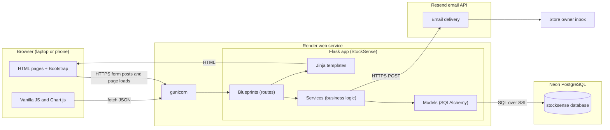
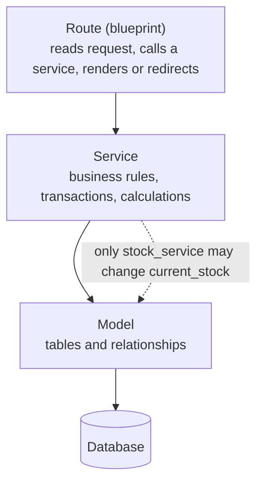
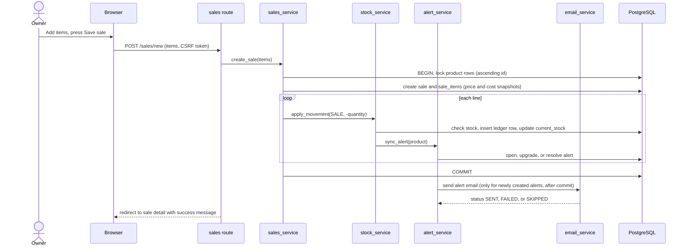
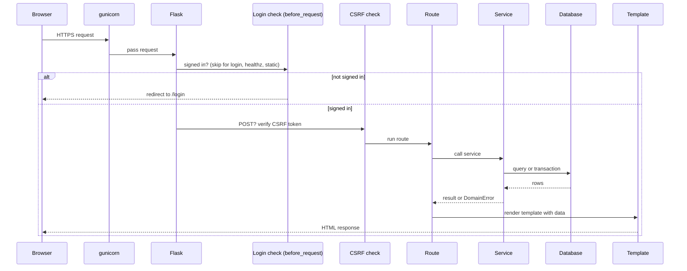
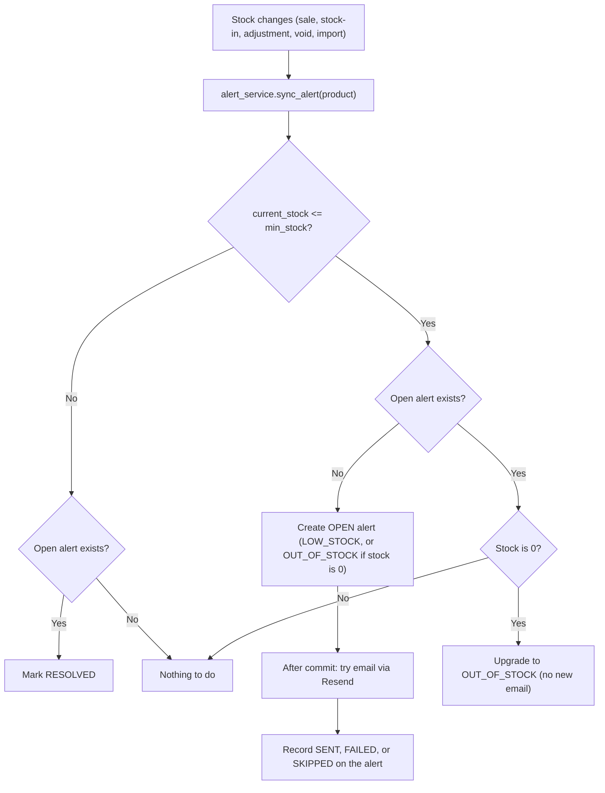
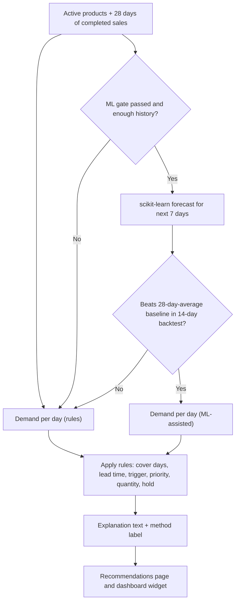

# StockSense — Optimised Retail Inventory System

A small, practical inventory and sales ledger for a single store owner. StockSense focuses on correctness, auditability, and simple operations: a ledger-style stock model, server-rendered UI, predictable alerting, and an optional lightweight forecast model.

GitHub renders the Mermaid diagrams in this file.

---

## Contents

- 1 — Summary
- 2 — Final tech stack (and reasoning)
- 3 — Component diagram
- 4 — Code layering
- 5 — Data flow: recording a sale
- 6 — Request lifecycle
- 7 — Alerts and email flow
- 8 — Recommendation & forecast flow
- 9 — External services
- 10 — Environments
- 11 — Security design
- 12 — Key design decisions
- 13 — Development & deployment
- 14 — Testing
- 15 — Contributing
- 16 — License

---

## 1. Summary

StockSense is built to let a store owner reliably record sales and inventory movements while keeping a full, auditable ledger of every change to stock. It emphasizes simple, readable code and deterministic behavior (no external AI calls). Alerts for low or out-of-stock items are created synchronously inside transactions and emailed only when necessary so the system works well on free hosting.

---

## 2. Final tech stack and why

| Layer | Choice | Why it fits |
|---|---|---|
| Frontend | Server-rendered Jinja templates, Bootstrap 5, Bootstrap Icons, Chart.js, small vanilla JS | One language/codebase, fast to ship, responsive UI. Charts via Chart.js. |
| Backend | Python 3.11+, Flask (app factory, blueprints) | Lightweight and easy to read for beginners. Blueprints keep features modular. |
| ORM / Migrations | Flask-SQLAlchemy, Flask-Migrate (Alembic) | ORM safety, readable models, and versioned schema changes. |
| Database | PostgreSQL on Neon (free tier) | Real transactions & row locking required by the ledger; free plan fits capstone needs. |
| Auth | Flask-Login (session-based), Werkzeug password hashing | Simple secure owner-only access (no public registration). |
| Forms / Security | Flask-WTF (form handling + CSRF) | Validates inputs and blocks CSRF. |
| AI/Forecasting | No external AI. Optional scikit-learn forecast (NumPy) running locally | Deterministic, explainable, and cost-free. Rules are the fallback. |
| Hosting | Render (free) using gunicorn | GitHub-deployable, supports Python; beware cold starts. |
| Email | Resend (REST API) via requests | Simple HTTP-based sending, free tier available. |
| Testing | pytest with in-memory SQLite | Fast CI-friendly tests. |
| Tools | VS Code, python-venv, python-dotenv | Standard beginner-friendly tooling. |

Locked trade-offs:
- Server-rendered pages (not SPA) for simplicity.
- No background jobs — alerts and emails are handled around event commits so system is simple on sleeping hosts.
- PostgreSQL in production and SQLite in tests for fast local tests.

---

## 3. Component diagram



---

## 4. Code layering (the rule that keeps the project simple)



Principles:
- Routes stay thin (no business rules).
- Services own business logic and transactions.
- Models represent data only.
- `stock_service.apply_movement()` is the only place allowed to mutate `current_stock`.

---

## 5. Data flow: recording a sale



If any validation or stock check fails, the DB transaction rolls back and the owner sees a clear error listing product and available quantity.

---

## 6. Request lifecycle (any page)



---

## 7. Alerts and email flow



Design points:
- Only one open alert per product (DB partial unique index).
- Email is attempted only for newly created alerts and only after the DB commit so that sleeping hosts don't require background schedulers.
- Failures to send email mark the alert as FAILED or SKIPPED but do not roll back the sale.

---

## 8. Recommendation and forecast flow



Notes:
- ML is optional and gated by backtesting; rules always remain available and documented in the UI.
- The UI clearly shows whether a number came from the rules or ML-assisted forecast.

---

## 9. External services

| Service | Used for | Free-tier behavior to plan around | If it fails |
|---|---|---|---|
| Neon (PostgreSQL) | Persistent data | DB sleeps when idle; first query is slower | App retries next request; otherwise shows 500 |
| Render | Hosting | Sleeps after ~15 idle minutes; ephemeral filesystem | Cold starts, no local persistence |
| Resend | Alert and summary email | Daily/monthly send limits | Email marked FAILED/SKIPPED, core flows still succeed |
| GitHub | Code + deploy trigger | None | Deploys are blocked until resolved |
| CDNs (Bootstrap, Chart.js) | UI assets | None | Styling or charts degrade, but functionality remains |

---

## 10. Environments

| Environment | Database | Config | Notes |
|---|---|---|---|
| Development | Neon project `stocksense-dev` | `.env` (not committed) | `flask run` locally |
| Testing | In-memory SQLite | `TestingConfig` | `pytest -q` |
| Production | Neon project `stocksense-prod` | Render environment variables | `DEMO_MODE=true` enables demo credentials |

---

## 11. Security design

- Passwords hashed with Werkzeug; sessions signed with `SECRET_KEY`.
- Global login requirement; only allow-listed endpoints skip auth (`auth.login`, `healthz`, `static`).
- CSRF protection via Flask-WTF on all POSTs; JSON POSTs include an `X-CSRFToken` header.
- Cookies set Secure, HttpOnly, SameSite=Lax in production.
- No registration route; owner account created from CLI.
- Secrets only in environment variables; `.env` is in `.gitignore`.
- All DB access via ORM (parameterized queries); Jinja auto-escapes output.
- CSV uploads are size-limited (1 MB), MIME/type-checked, parsed in memory only.

---

## 12. Key design decisions

| Decision | Reason |
|---|---|
| Ledger + cached `current_stock` | Audit trail + fast reads; consistency validated by CLI checks |
| Snapshot price & cost on sale lines | Past records remain immutable for profit calculations |
| Sales are voided, never edited | Keeps ledger integrity and logic simple |
| One open alert per product (partial unique index) | DB prevents duplicates and simplifies alert handling |
| Email only on alert creation (post-commit) | Works without schedulers on sleeping hosts |
| All tables created in the first migration | Fewer migrations and potential confusion for beginners |

---

## 13. Development & deployment

Local development:
1. Clone repository.
2. Create a Python 3.11+ virtualenv and install dev requirements.
3. Create `.env` file (do not commit). Example keys: DATABASE_URL, SECRET_KEY, RESEND_API_KEY, RESEND_FROM.
4. Run `flask run` or `gunicorn 'app:create_app()'` for a production-like server.

Deploy:
- Deploy to Render from the repository; set environment variables on the Render dashboard.
- Use Neon for production Postgres; create separate Neon projects for dev and prod.

If you want, I can create a sample `.env.template` and a Render deployment guide next.

---

## 14. Testing

- Unit and integration tests run with pytest using in-memory SQLite for speed.
- Tests cover services and model invariants (ledger consistency, alert lifecycle, transactions).
- Run tests:
  ```bash
  pytest -q
  ```

Note: Row-locking and some transactional behavior should be manually verified against PostgreSQL during QA.

---

## 15. Contributing

- Follow the repository's code style and testing patterns.
- Keep routes thin; put business logic in services.
- Document any schema changes in migrations.
- Create issues for feature requests or bugs. For significant changes, open a PR with tests and a short design note.

---

## 16. License

Pick a license for your project (MIT is recommended for capstone/demo projects). Add a `LICENSE` file to the repo.

---

If you'd like, I can:
- Commit this README.md to `main` for you.
- Add a `.env.template` and a simple `render.md` deployment guide.
- Create a basic `CONTRIBUTING.md` and `LICENSE` file (MIT).

Which of those would you like next?
