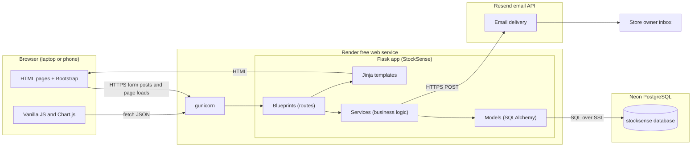
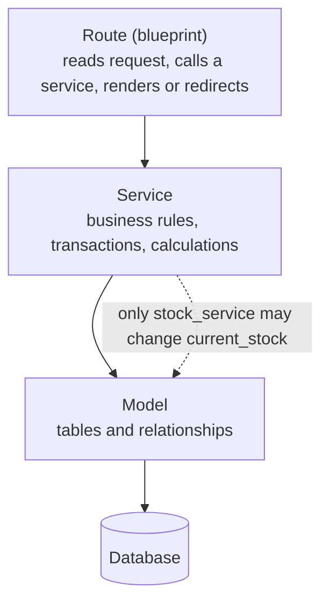
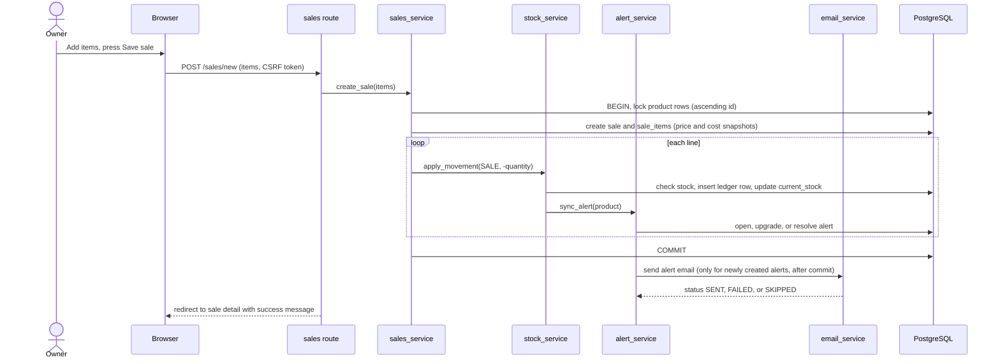
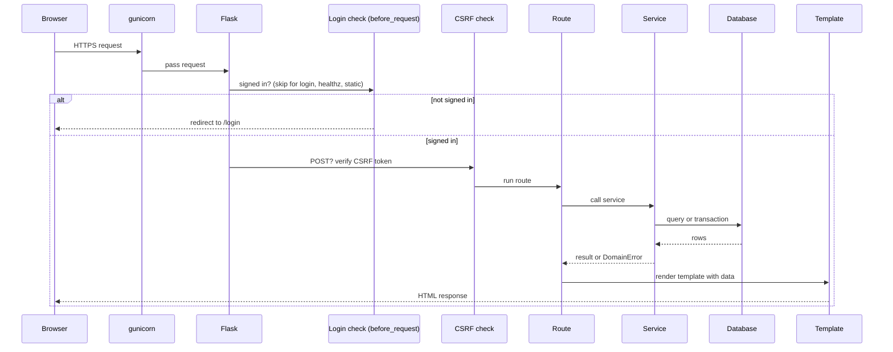
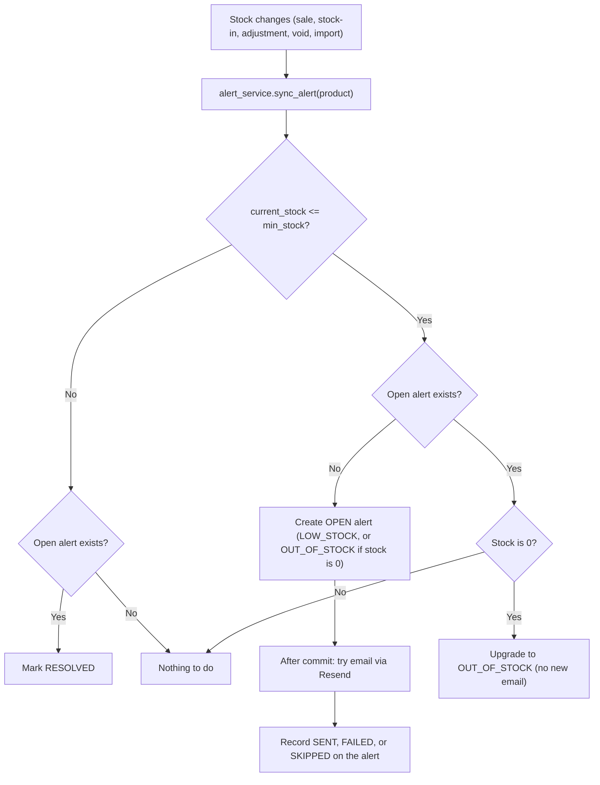
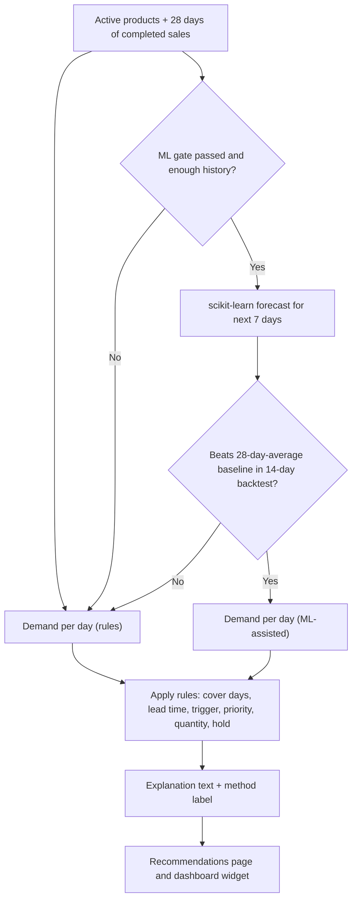

# StockSense: System Architecture

Version 1.0 (Day 2 design). Source documents: `PRD.md`, `IMPLEMENTATION-BLUEPRINT.md`. GitHub renders the Mermaid diagrams below.

## 1. Final Tech Stack and Why

| Layer | Choice | Why it is the best fit |
|---|---|---|
| Frontend | Server-rendered Jinja templates, Bootstrap 5, Bootstrap Icons, Chart.js, small vanilla JavaScript files | One codebase and one language (no separate JavaScript framework to learn). Bootstrap gives a responsive, polished UI quickly. Chart.js draws the dashboard charts with little code. |
| Backend | Python 3.11+ with Flask, organized as an app factory with blueprints | You already know Python. Flask is small and readable, so a beginner can see how a request flows. Blueprints keep features separate. |
| ORM and migrations | Flask-SQLAlchemy and Flask-Migrate (Alembic) | Python classes become tables, queries are safe from SQL injection, and schema changes are versioned. |
| Database | PostgreSQL on Neon (free plan) | Real transactions and row locking, which the stock ledger needs. Free, permanent, and no card required. Scales to zero when idle, so the first query after a pause is slower. |
| Authentication | Flask-Login (sessions) with Werkzeug password hashing, one owner account created by a CLI command | Simple and secure for a single-owner product. No sign-up page means no public attack surface. |
| Forms and security | Flask-WTF (forms and CSRF protection) | Validates input on the server and blocks cross-site request forgery. |
| AI model or API | **No external AI API.** Rules engine plus an optional small scikit-learn model (NumPy) running inside the app | Free, deterministic, explainable, and fast. An external model would add cost, latency, and unpredictable output to something that must show its math. |
| Hosting | Render free web service, started with gunicorn | Free, deploys from GitHub, and supports Python. Cold starts after 15 idle minutes are documented. |
| Email | Resend free plan, called through its REST API with `requests` | Free, no SMTP setup, simple HTTP call. Failures are recorded, never fatal. |
| Testing | pytest with in-memory SQLite | Fast tests with no database setup. |
| Version control | Git and GitHub | Required for deployment and for the capstone record. |
| Tools | VS Code, Python virtual environment, `python-dotenv` | Standard beginner-friendly tooling. |

### Locked trade-offs
- **Server-rendered pages instead of a single-page app:** fewer moving parts and faster delivery. The JSON endpoints exist only for live search and charts.
- **No background jobs:** the free host sleeps, so alerts fire on events (when stock changes), not on a timer.
- **PostgreSQL in production, SQLite in tests:** tests run fast. Row locking is only exercised against PostgreSQL during manual checks.

## 2. Component Diagram

## 3. Code Layering (the rule that keeps the project simple)

- **Routes stay thin.** No business rules inside routes.
- **Services own the rules.** `stock_service.apply_movement()` is the only code allowed to change `current_stock`.
- **Models describe data only.**

## 4. Data Flow: Recording a Sale (the most important flow)

If any line fails (for example, not enough stock), the transaction rolls back, nothing is saved, and the owner sees a message naming the product and available quantity.

## 5. Request Lifecycle (any page)

## 6. Alerts and Email Flow

## 7. Recommendation and Forecast Data Flow

**AI interaction:** there is no third-party model call. The optional forecast is a small local model, trained on demand for the products shown, with the rules as the always-available fallback. The UI always states which method produced a number.

## 8. External Services

| Service | Used for | Free-tier behavior to plan around | If it fails |
|---|---|---|---|
| Neon (PostgreSQL) | All persistent data | Database sleeps when idle, so the first query can be slow | App retries on the next request. Errors show the 500 page |
| Render | Hosting | Web service sleeps after about 15 idle minutes. Filesystem is not permanent | First visit is slow. Nothing important lives on disk |
| Resend | Alert and summary emails | Daily and monthly limits. A test sender may only deliver to your own address | Alert marked FAILED or SKIPPED. Sale and alert still succeed |
| GitHub | Code and deploy trigger | None | Deploys pause |
| CDNs (Bootstrap, Chart.js) | UI assets | None | UI loses styling or charts. Core pages still work |

## 9. Environments

| Environment | Database | Config | Notes |
|---|---|---|---|
| Development | Neon project `stocksense-dev` | `.env` file (never committed) | `flask run` locally |
| Testing | In-memory SQLite | `TestingConfig` | `pytest -q` |
| Production | Neon project `stocksense-prod` | Render environment variables | `DEMO_MODE=true` shows demo credentials |

## 10. Security Design

- Passwords hashed (Werkzeug). Sessions signed with `SECRET_KEY`.
- Global login requirement with a short allow-list (`auth.login`, `healthz`, `static`).
- CSRF protection on every POST. JSON POSTs send the token in an `X-CSRFToken` header.
- Production cookies are `Secure`, `HttpOnly`, and `SameSite=Lax`.
- No registration route. The owner is created from the command line.
- Secrets only in environment variables. `.env` is in `.gitignore`.
- All database access goes through the ORM (parameterized queries). Jinja auto-escapes output.
- File uploads (CSV) are size-limited (1 MB), type-checked, and parsed in memory, never saved to disk.

## 11. Key Design Decisions

| Decision | Reason |
|---|---|
| Ledger plus cached `current_stock` | Full audit trail and fast reads. A CLI check proves they agree |
| Snapshot price and cost on sale lines | Price changes never rewrite history or profit |
| Sales are voided, never edited | Keeps the ledger honest and the logic simple |
| One open alert per product (partial unique index) | The database itself prevents duplicates |
| Email only on alert creation | Works without schedulers on a sleeping host |
| All tables created in the first migration | Fewer migrations, fewer beginner mistakes |
