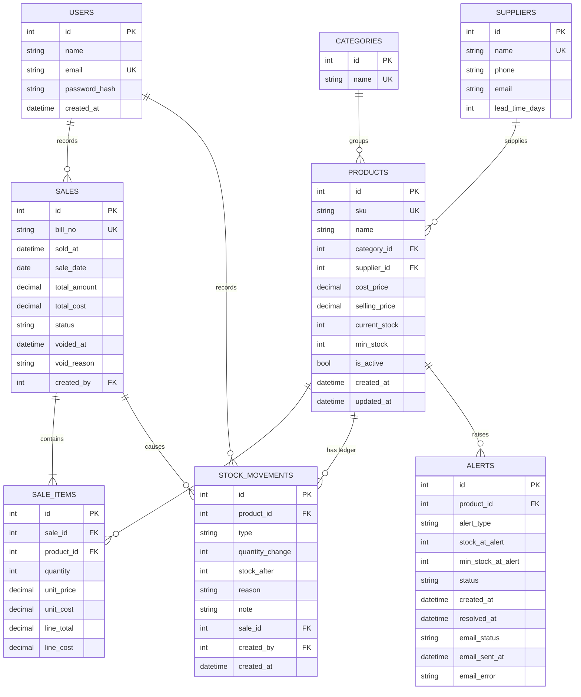

# StockSense: Database Schema

Version 1.0 (Day 2 design). PostgreSQL in development and production, SQLite in tests. Enumerations are stored as short strings protected by `CHECK` constraints so both databases behave the same.

## 1. Entity Relationship Diagram

## 2. Tables

Notation: **PK** primary key, **FK** foreign key, **UK** unique, **NN** not null.

### 2.1 `users`
| Field | Type | Rules |
|---|---|---|
| id | Integer | PK |
| name | String(100) | NN |
| email | String(255) | NN, UK, stored lowercase |
| password_hash | String(255) | NN |
| created_at | DateTime (timezone) | NN, default now (UTC) |

One row in practice. Created by `flask create-owner`.

### 2.2 `categories`
| Field | Type | Rules |
|---|---|---|
| id | Integer | PK |
| name | String(80) | NN, UK (case-insensitive check done in the service) |

### 2.3 `suppliers`
| Field | Type | Rules |
|---|---|---|
| id | Integer | PK |
| name | String(120) | NN, UK |
| phone | String(30) | optional |
| email | String(255) | optional |
| lead_time_days | Integer | NN, default 3, CHECK between 0 and 60 |

### 2.4 `products`
| Field | Type | Rules |
|---|---|---|
| id | Integer | PK |
| sku | String(40) | NN, UK, stored uppercase, never changes after creation |
| name | String(150) | NN |
| category_id | Integer | NN, FK `categories.id`, ON DELETE RESTRICT |
| supplier_id | Integer | optional, FK `suppliers.id`, ON DELETE RESTRICT |
| cost_price | Numeric(12,2) | NN, CHECK 0 or more |
| selling_price | Numeric(12,2) | NN, CHECK 0 or more |
| current_stock | Integer | NN, default 0, CHECK 0 or more. **Changed only by `stock_service`** |
| min_stock | Integer | NN, default 0, CHECK 0 or more |
| is_active | Boolean | NN, default true (false means archived) |
| created_at / updated_at | DateTime (timezone) | NN, default now (UTC) |

Indexes: `products(name)`, `products(category_id)`, `products(supplier_id)`.

### 2.5 `sales`
| Field | Type | Rules |
|---|---|---|
| id | Integer | PK |
| bill_no | String(20) | UK. Format `B-000123`. Set in the same transaction right after the row gets its id (never empty on committed rows) |
| sold_at | DateTime (timezone) | NN, UTC. Past dates allowed only through CSV import |
| sale_date | Date | NN, the **IST calendar date** of `sold_at`, used for all daily grouping |
| total_amount | Numeric(12,2) | NN, CHECK 0 or more |
| total_cost | Numeric(12,2) | NN, CHECK 0 or more |
| status | String(12) | NN, default `COMPLETED`, CHECK in (`COMPLETED`, `VOIDED`) |
| voided_at | DateTime (timezone) | optional |
| void_reason | String(255) | optional |
| created_by | Integer | optional, FK `users.id` |

Consistency CHECK: `(status = 'COMPLETED' AND voided_at IS NULL) OR (status = 'VOIDED' AND voided_at IS NOT NULL AND void_reason IS NOT NULL)`.
Indexes: `sales(sale_date)`, `sales(status)`.

### 2.6 `sale_items`
| Field | Type | Rules |
|---|---|---|
| id | Integer | PK |
| sale_id | Integer | NN, FK `sales.id`, ON DELETE CASCADE |
| product_id | Integer | NN, FK `products.id`, ON DELETE RESTRICT |
| quantity | Integer | NN, CHECK above 0 |
| unit_price | Numeric(12,2) | NN, snapshot of selling price, CHECK 0 or more |
| unit_cost | Numeric(12,2) | NN, snapshot of cost price, CHECK 0 or more |
| line_total | Numeric(12,2) | NN, `quantity * unit_price` |
| line_cost | Numeric(12,2) | NN, `quantity * unit_cost` |

Unique: (`sale_id`, `product_id`), so the same product cannot appear twice on a bill (the service merges duplicate lines).
Index: `sale_items(product_id)`.

### 2.7 `stock_movements` (the ledger)
| Field | Type | Rules |
|---|---|---|
| id | Integer | PK |
| product_id | Integer | NN, FK `products.id`, ON DELETE RESTRICT |
| type | String(12) | NN, CHECK in (`OPENING`, `STOCK_IN`, `SALE`, `ADJUSTMENT`, `SALE_VOID`) |
| quantity_change | Integer | NN, CHECK not 0 |
| stock_after | Integer | NN, CHECK 0 or more |
| reason | String(30) | optional, but required for `ADJUSTMENT`. Values: `DAMAGED`, `LOST_THEFT`, `COUNT_CORRECTION`, `RETURNED_TO_SUPPLIER`, `OTHER` |
| note | String(255) | optional |
| sale_id | Integer | optional, FK `sales.id`, ON DELETE RESTRICT |
| created_by | Integer | optional, FK `users.id` |
| created_at | DateTime (timezone) | NN, default now (UTC) |

Sign CHECK: `OPENING`, `STOCK_IN`, and `SALE_VOID` have positive change. `SALE` has negative change. `ADJUSTMENT` may be either.
Adjustment CHECK: `type <> 'ADJUSTMENT' OR reason IS NOT NULL`.
Index: `stock_movements(product_id, created_at)`.

### 2.8 `alerts`
| Field | Type | Rules |
|---|---|---|
| id | Integer | PK |
| product_id | Integer | NN, FK `products.id`, ON DELETE RESTRICT |
| alert_type | String(15) | NN, CHECK in (`LOW_STOCK`, `OUT_OF_STOCK`) |
| stock_at_alert | Integer | NN, CHECK 0 or more |
| min_stock_at_alert | Integer | NN, CHECK 0 or more |
| status | String(10) | NN, default `OPEN`, CHECK in (`OPEN`, `RESOLVED`) |
| created_at | DateTime (timezone) | NN, default now (UTC) |
| resolved_at | DateTime (timezone) | optional |
| email_status | String(12) | NN, default `NOT_SENT`, CHECK in (`NOT_SENT`, `SENT`, `FAILED`, `SKIPPED`) |
| email_sent_at | DateTime (timezone) | optional |
| email_error | String(255) | optional, short failure reason |

**Partial unique index:** `uq_alerts_one_open_per_product` on (`product_id`) WHERE `status = 'OPEN'`. The database itself guarantees one open alert per product.
Consistency CHECK: `(status = 'RESOLVED') = (resolved_at IS NOT NULL)`.
Index: `alerts(product_id, status)`.

## 3. Delete and Archive Rules

| Entity | Rule |
|---|---|
| Product | Never hard-deleted once it has history. Archive with `is_active = false` |
| Category or supplier | Delete allowed only if no product uses it (enforced by RESTRICT and a friendly message) |
| Sale | Never deleted. Voided instead |
| Ledger rows | Never edited or deleted (except the demo `--reset` command) |
| User | One owner, never deleted |

## 4. Transaction Boundaries

| Operation | One transaction covers |
|---|---|
| Create product | Product row + OPENING ledger row (if opening stock above 0) + alert sync |
| Stock-in or adjustment | Ledger row + `current_stock` + alert sync |
| Create sale | Sale + items + one SALE ledger row per line + stock updates + alert sync |
| Void sale | Status change + one SALE_VOID ledger row per line + stock updates + alert sync |
| CSV import | Entire file (all rows or none) |

Email is attempted after commit, and its result is saved afterward in a second small update.

## 5. Key Query Patterns

| Need | Approach |
|---|---|
| Daily revenue and profit | Group completed sales by `sale_date`, sum `total_amount` and `total_amount - total_cost` |
| Units sold per product (28 or 30 days) | Join `sale_items` to completed `sales`, filter `sale_date`, group by `product_id` |
| Inventory value | Sum `current_stock * cost_price` and `current_stock * selling_price` for active products |
| Open alerts | `alerts` where `status = 'OPEN'` |
| Ledger consistency check | For each product, sum of `quantity_change` equals `current_stock`, and each `stock_after` follows the previous row |

## 6. Validation Against Every User Story

| Story | Tables and constraints that support it |
|---|---|
| US-01 Login | `users.email` unique, `password_hash` |
| US-02 Logout | Session only (no table) |
| US-03 Add product | `products` (unique SKU, price and stock CHECKs), `stock_movements` OPENING row |
| US-04 Edit product | `products` (SKU immutable by service rule, stock not editable) |
| US-05 Search and filter | Indexes on `products(name)`, category, supplier. Status badge computed from `current_stock` and `min_stock` |
| US-06 Archive | `products.is_active`, RESTRICT keeps history safe |
| US-07 Categories | `categories.name` unique, RESTRICT on delete |
| US-08 Suppliers | `suppliers.lead_time_days` with CHECK |
| US-09 Stock-in | `stock_movements` type `STOCK_IN` |
| US-10 Adjustment | `stock_movements` type `ADJUSTMENT`, reason required by CHECK, `stock_after` 0 or more |
| US-11 Movement history | `stock_movements(product_id, created_at)` index |
| US-12 Record sale | `sales`, `sale_items` snapshots, `bill_no`, SALE ledger rows |
| US-13 Over-stock rejected | `products.current_stock` CHECK plus row locking and service validation |
| US-14 Sales history | `sales.sale_date` and `status` indexes |
| US-15 Sale detail | `sale_items` snapshots (`line_total`, `line_cost`) give revenue, cost, profit |
| US-16 Void | `sales.status`, `voided_at`, `void_reason` (CHECK), SALE_VOID ledger rows |
| US-17 Products CSV | Same tables as US-03, one transaction for the whole file |
| US-18 Sales CSV | Same tables as US-12 with historical `sold_at` and `sale_date` |
| US-19 Demo data | All tables plus `flask verify-ledger` |
| US-20 In-app alerts | `alerts` with open-per-product partial unique index |
| US-21 Out of stock | `alerts.alert_type = 'OUT_OF_STOCK'` |
| US-22 Email on alert | `alerts.email_status`, `email_sent_at`, `email_error` |
| US-23 Summary email | Reads open `alerts` (no new table) |
| US-24 Dashboard KPIs | Aggregates over `sales`, `sale_items`, `products`, `alerts` |
| US-25 Trend chart | `sales.sale_date` grouping, zero-filled in the service |
| US-26 Top sellers | `sale_items.line_total` grouped by product |
| US-27 Inventory value | `products.current_stock`, `cost_price`, `selling_price` |
| US-28 Movers | Units sold per product from `sale_items` and `sales` |
| US-29 Dead stock | Slow movers joined to `products` for stock value |
| US-30 Recommendations | Units sold, `current_stock`, `min_stock`, `suppliers.lead_time_days` |
| US-31 Supplier grouping | `products.supplier_id` |
| US-32 ML forecast | Daily series from `sales` and `sale_items` (no new table) |
| US-33 Hold advice | Same inputs as US-30 |
| US-34 Responsive | UI only |
| US-35 Deployed | Production Neon database |
| US-36 Friendly errors | Constraint violations mapped to messages by services |

**Result:** all 36 stories are supported. No extra tables are required.

## 7. Changes from Blueprint Section 0.5

| Change | Reason |
|---|---|
| `products.category_id` is required | Filters, imports, and reports stay simple |
| Added `alerts.email_error` | Debugging failed emails without log access |
| Added unique (`sale_id`, `product_id`) on `sale_items` | Prevents duplicate lines on one bill |
| Added sign and adjustment CHECKs on `stock_movements` | Catches ledger bugs in the database |
| `sales.bill_no` assigned immediately after first insert | The id is needed to build the number |
