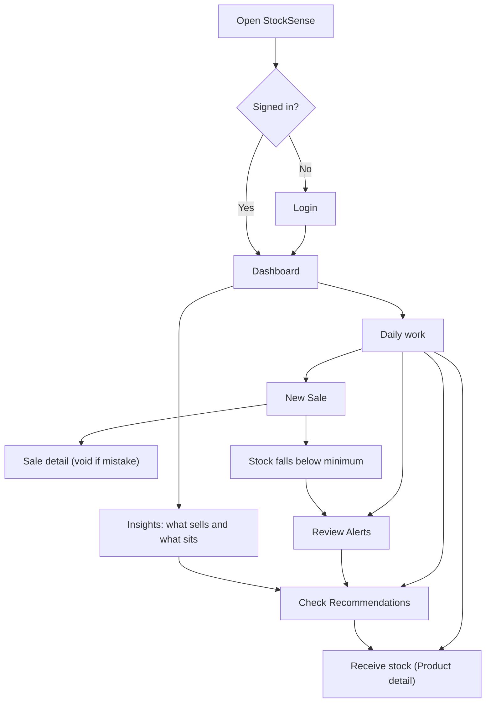
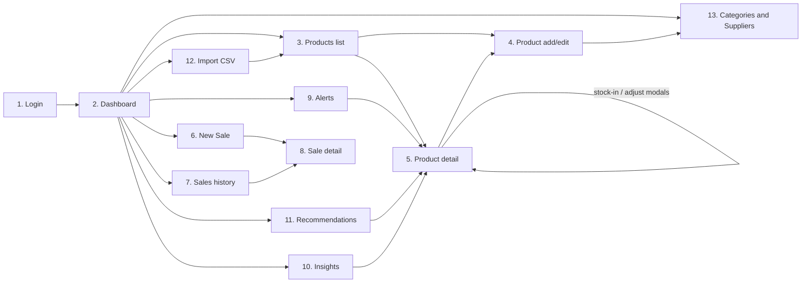

# StockSense: UI, User Flow, and Wireframes

Version 1.0 (Day 2 design). Low-fidelity layouts. Every screen exists to serve at least one user story.

## 1. Core User Journey



## 2. Screen Flow



## 3. Navigation

**Top navbar (collapses into a hamburger menu below 992px width):**

| Item | Goes to | Notes |
|---|---|---|
| Dashboard | `/dashboard` | Brand name also links here |
| **+ New Sale** | `/sales/new` | Highlighted button, always visible |
| Products | `/products` | |
| Sales | `/sales` | History |
| Alerts | `/alerts` | Red badge with open-alert count |
| Insights | `/insights` | |
| Recommendations | `/recommendations` | |
| More (dropdown) | Import CSV, Categories and Suppliers | |
| User menu | Logout | Posts to `/logout` |

**Breadcrumb-style "Back" links** appear on detail and form screens (for example, Product detail back to Products).

## 4. Wireframes

Legend: `[Button]`, `(input)`, `{select}`, `▓` chart area, `⚠` alert.

### 4.1 Login (US-01, US-35)
```
+--------------------------------------+
|              StockSense              |
|   Intelligent inventory for retail   |
|                                      |
|  Email     (____________________)    |
|  Password  (____________________)    |
|  [x] Remember me                     |
|  [        Sign in         ]          |
|                                      |
|  Demo: owner@demo.com / ••••••       |  <- only when DEMO_MODE=true
+--------------------------------------+
```
**Why it exists:** gate to all data. **States:** wrong password error, loading on submit.

### 4.2 Dashboard (US-24 to US-27)
```
+-----------------------------------------------------------+
| Navbar                                                    |
+-----------------------------------------------------------+
| Today Revenue | Today Profit | 30d Revenue | 30d Profit   |
|   ₹12,450     |   ₹3,120     |  ₹3,84,200  |  ₹91,500     |
+-----------------------------------------------------------+
| Inventory value (cost)  | Open alerts | Out of stock        |
|   ₹4,12,000             |     7       |      2              |
+-----------------------------------------------------------+
| Revenue and profit      [7 days][30 days]                 |
| ▓▓▓▓▓▓▓▓▓▓▓▓▓▓▓▓▓▓▓▓▓▓▓▓▓▓▓▓▓▓▓▓▓▓▓▓▓▓▓▓▓▓▓▓▓▓▓▓▓▓▓▓▓      |
+-----------------------------+-----------------------------+
| Top 5 products (30 days)    | Needs attention             |
| ▓▓▓▓▓▓ bars                 | ⚠ Rice 5kg: 3 days left     |
|                             | ⚠ Soap: out of stock        |
|                             | [View all recommendations]  |
+-----------------------------+-----------------------------+
```
**Why:** one-glance business health. **States:** charts show spinner then "No sales yet" if empty.

### 4.3 Products list (US-05, US-06)
```
Products                                   [+ Add product]
(Search name or SKU...) {Category} {Supplier} {Status} [x] Show archived
+------+---------------------+--------+-------+-------+--------+
| SKU  | Name                | Stock  | Min   | Price | Status |
+------+---------------------+--------+-------+-------+--------+
| RICE | Basmati Rice 5 kg   | 18     | 10    | ₹485  | [OK]   |
| SOAP | Lux Soap 100 g      | 0      | 12    | ₹38   | [OUT]  |
+------+---------------------+--------+-------+-------+--------+
                        « 1 2 3 »
```
Row click opens detail. **Mobile:** table scrolls inside its box, SKU and Name stay visible. **Empty state:** "No products yet. Add one or import a CSV."

### 4.4 Product add and edit (US-03, US-04)
```
Add product                              [Back to Products]
SKU (____)*       Name (__________________)*
{Category}*       {Supplier}
Cost price (___)* Selling price (___)*
Opening stock (_) Minimum stock (_)
⚠ Selling price is below cost price
[Save product]  [Cancel]
```
Edit mode: SKU read-only, opening stock hidden (stock changes happen on the product page).

### 4.5 Product detail (US-09, US-10, US-11)
```
Basmati Rice 5 kg   SKU: RICE-5KG   [Edit] [Archive]
+---------------+---------------+---------------+
| In stock: 18  | Minimum: 10   | [OK]          |
| Cost ₹410  Price ₹485  Supplier: Sharma Traders |
+------------------------------------------------+
[+ Stock in]  [Adjust stock]
Movement history
+----------+-----------+--------+-------+----------------+
| Date     | Type      | Change | After | Note / Bill    |
+----------+-----------+--------+-------+----------------+
| 08 Oct   | SALE      | -3     | 18    | B-000412       |
| 07 Oct   | STOCK_IN  | +40    | 21    | Weekly order   |
+----------+-----------+--------+-------+----------------+
```
**Stock in modal:** (Quantity) (Note) [Save]. **Adjust modal:** {Add or Remove} (Quantity) {Reason} (Note) [Save].

### 4.6 New Sale (US-12, US-13)
```
New sale
(Search product by name or SKU...)
   ┌ Basmati Rice 5 kg · ₹485 · 18 in stock ┐  <- live results
+---------------------+--------+--------+--------+-----+
| Product             | Price  | Qty    | Total  |     |
+---------------------+--------+--------+--------+-----+
| Basmati Rice 5 kg   | ₹485   | (2)    | ₹970   | [x] |
| Lux Soap 100 g      | ₹38    | (6)    | ₹228   | [x] |
+---------------------+--------+--------+--------+-----+
                           Items: 2     Total: ₹1,198
[Save sale]  [Clear]
```
Errors appear above the table (for example, "Only 3 of Lux Soap in stock"). **Mobile:** each line becomes a stacked card.

### 4.7 Sales history (US-14)
```
Sales            From (date) To (date) {Status}  [Filter]
+----------+----------+-------+----------+-----------+
| Bill     | Date     | Items | Total    | Status    |
+----------+----------+-------+----------+-----------+
| B-000412 | 08 Oct   | 5     | ₹1,198   | Completed |
| B-000410 | 08 Oct   | 2     | ₹340     | Voided    |
+----------+----------+-------+----------+-----------+
```

### 4.8 Sale detail and void (US-15, US-16)
```
Bill B-000412         Completed        [Void sale]
08 Oct 2026, 4:12 PM
+---------------------+-----+--------+--------+
| Product             | Qty | Price  | Total  |
+---------------------+-----+--------+--------+
| Basmati Rice 5 kg   | 2   | ₹485   | ₹970   |
+---------------------+-----+--------+--------+
Revenue ₹1,198   Cost ₹934   Profit ₹264
```
Void opens a confirm dialog: (Reason)* [Confirm void] [Cancel].

### 4.9 Alerts (US-20 to US-23)
```
Alerts   [Open (7)] [Resolved]        [Email me a summary]
+-----+---------------------+-------+-----+---------+
|     | Product             | Stock | Min | Emailed |
+-----+---------------------+-------+-----+---------+
| 🔴  | Lux Soap 100 g      | 0     | 12  | Sent    |
| 🟠  | Basmati Rice 5 kg   | 8     | 10  | Sent    |
+-----+---------------------+-------+-----+---------+
```
Red means out of stock, orange means low. Rows link to the product. **Empty state:** "All stocked up. No alerts."

### 4.10 Insights (US-28, US-29)
```
Insights   [Fast] [Steady] [Slow]
Fast movers = top sellers in the last 30 days
+---------------------+-------+-----------+-------+
| Product             | Sold  | Per day   | Stock |
+---------------------+-------+-----------+-------+
| Basmati Rice 5 kg   | 140   | 4.7       | 18    |
+---------------------+-------+-----------+-------+
Slow tab adds a column: Stock value tied up (₹), sorted highest first.
```

### 4.11 Recommendations (US-30, US-31, US-33)
```
Recommendations     View: (• By priority  ○ By supplier)   [Copy order list]
CRITICAL (2)
+--------------------------------------------------------------+
| Basmati Rice 5 kg                          Order 40 units    |
| Sells about 6/day, 3 days of stock left, Sharma Traders      |
| takes 3 days to deliver.      Method: recent average         |
+--------------------------------------------------------------+
SOON (5)  ...
HOLD, DO NOT REORDER (4)
| Candle Pack: no sales in 28 days, ₹6,400 tied up |
```

### 4.12 Import CSV (US-17, US-18)
```
Import data
Products   [Download template]   (Choose file)  [Import products]
Sales      [Download template]   (Choose file)  [Import sales]
Tips: UTF-8 CSV, max 1 MB and 2,000 rows. The whole file is checked first.
--- after upload ---
✔ 58 products imported            or
✖ 3 problems found, nothing imported
| Row | Column        | Problem                 |
| 12  | selling_price | Must be a number        |
```

### 4.13 Categories and Suppliers (US-07, US-08)
```
Categories                         Suppliers
(New category)  [Add]              (Name)(Phone)(Email)(Lead days) [Add]
Groceries   [Rename][Delete]       Sharma Traders  3 days [Edit][Delete]
```
Delete is disabled with a tooltip when the item is in use.

### 4.14 Error pages (US-36)
```
404  We could not find that page.   [Back to Dashboard]
500  Something went wrong on our side. Please try again. [Back to Dashboard]
```

## 5. Responsive Behavior (US-34)

| Width | Behavior |
|---|---|
| 1280px and up | Full navbar, multi-column dashboard grids |
| 768px | Navbar collapses, dashboard cards in 2 columns |
| 375px | Single column, tables scroll inside their container, New Sale lines become cards, buttons are full width |

## 6. Standard UI States

| State | Pattern |
|---|---|
| Loading | Spinner in chart containers. Buttons disable and show "Saving..." on submit |
| Empty | Short explanation plus the next action button |
| Error | Red message at the top of the form and next to the field |
| Success | Green flash message that fades |
| Destructive actions | Confirm dialog (void, archive, delete) |

## 7. Screen to Story Coverage

| Screen | Stories served |
|---|---|
| Login | US-01, US-02, US-35 |
| Dashboard | US-24, US-25, US-26, US-27 |
| Products list | US-05, US-06 |
| Product add/edit | US-03, US-04 |
| Product detail | US-09, US-10, US-11 |
| New Sale | US-12, US-13 |
| Sales history | US-14 |
| Sale detail | US-15, US-16 |
| Alerts | US-20, US-21, US-22, US-23 |
| Insights | US-28, US-29 |
| Recommendations | US-30, US-31, US-32, US-33 |
| Import | US-17, US-18 |
| Categories and Suppliers | US-07, US-08 |
| Error pages and states | US-36 |
| Responsive rules | US-34 |
| (CLI) Demo data | US-19 |

**Every Must story has a screen. Every screen serves a story.**
